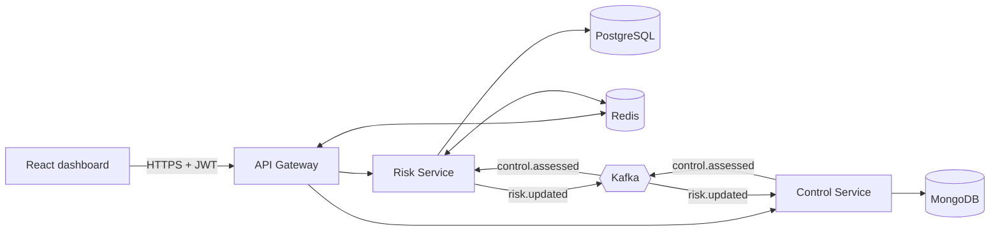

# Risk & Control Assessment Platform

**A security control fails its test. One second later, every risk that depended on it is re-scored and every open dashboard turns red.**

A working risk-management (GRC) system built as event-driven microservices: Java 25, Spring Boot, Kafka, PostgreSQL, MongoDB, Redis, React, on Docker and Kubernetes. Load-tested, attacked and crashed on purpose, with every number below reproducible.

[](https://github.com/SanyamKhaiwal/risk-control-platform/actions/workflows/ci.yml)
[](https://github.com/SanyamKhaiwal/risk-control-platform/actions/workflows/k8s.yml)

<!-- Demo video: added later -->

## Why it exists

Banks keep a **risk register**: everything that could go wrong, scored by how likely and how bad. **Controls** (multi-factor login, backups, alerting) keep those risks small, and testers check that the controls really work.

When a control fails, the risks it protected are suddenly bigger than the register says. Enterprise tools catch up in overnight batches. **This platform catches up in about a second**, and shows exactly which test caused the change.

## The numbers

| | |
| --- | --- |
| ⚡ **4,000 live users** on one 1-CPU gateway | up from 200, by pushing changes instead of polling |
| 🛡️ **58 / 58 attacks blocked** | forged logins and events, data theft, injection, tampering, XSS |
| 🔄 **0 failed requests** | while every gateway was replaced under load on Kubernetes |
| 💥 **About 9 s to recover** | from a crashed service, with no event lost while Kafka was down |
| 🚀 **3.5× faster start-up** | with Java 25's ahead-of-time cache |
| ✅ **149 automated tests** | against real databases, plus the attacks, on every push |

All measured on a 4-core laptop.

## Try it in 3 commands

You need **Git**, **Docker Desktop** (6 GB+ memory) and **Node.js 22+**. Nothing else: Java, the databases, Kafka and Redis all run in Docker.

```bash
git clone https://github.com/SanyamKhaiwal/risk-control-platform.git
cd risk-control-platform
node scripts/start.mjs
```

It sets up passwords and keys, builds and starts 11 containers with health checks, loads demo data, and opens **http://localhost:5173**. The first run takes 5 to 10 minutes; after that, under one.

**Then the 30-second demo:** sign in as **carol** / `demo123`, open **Controls → MFA on admin accounts**, record **Doesn't work**, and watch *Account takeover of privileged users* jump from **Medium to Critical** on the Overview.

<details>
<summary><b>All demo users, addresses, and stopping it</b></summary>

| User | Role |
| --- | --- |
| `alice` | Risk owner: creates and scores risks |
| `bob` | Control owner: defines controls |
| `carol` | Tester: records whether controls work |
| `dave` | Viewer: read only |
| `erin` | Owner + tester: still can't test her own controls |

Password for all: `demo123`.

| What | Address |
| --- | --- |
| Dashboard | http://localhost:5173 |
| API Gateway | http://localhost:8080 |
| Grafana (monitoring) | http://localhost:3000 |
| Prometheus | http://localhost:9090 |

```bash
docker compose down       # stop, keep the data
docker compose down -v    # stop and wipe everything
```

**Trouble?** Make sure Docker Desktop is running, and that ports 5173, 8080, 3000, 5432, 27017, 6379 and 9092 are free. `docker compose logs <service>` shows what went wrong.

</details>

## How it works



1. The **Control Service** saves the test result and its event in **one transaction** (the outbox pattern): every saved result gets its event, and no event goes out for a result that wasn't saved.
2. The event is **signed** and travels through **Kafka**.
3. The **Risk Service** verifies it, re-scores every linked risk, and records what caused the change.
4. The **Gateway pushes** the new heat-map to every open screen.

<details>
<summary><b>How a risk is scored</b></summary>

- **Before controls:** likelihood × impact, each 1 to 5, so 1 to 25.
- A tested control counts as **1.0** (works), **0.5** (works partly) or **0** (doesn't work). Untested controls don't count.
- **Preventive** controls cut likelihood; **detective** and **corrective** controls cut impact.
- **Risk now** = reduced likelihood × reduced impact, never below 1.
- **Ratings:** Low 1–5 · Medium 6–11 · High 12–19 · Critical 20–25.

*Demo example:* account takeover scores 4 × 5 = 20 before controls. MFA working partly halves likelihood: 2 × 5 = 10, Medium. MFA fails: back to 4 × 5 = 20, Critical.

</details>

## Built with

- **Backend:** Java 25 · Spring Boot 4 · Spring Cloud Gateway · Spring Security (RS256 JWT)
- **Data and messaging:** PostgreSQL 17 · MongoDB 8 · Apache Kafka 4 · Redis 7.4
- **Frontend:** React 19 · TypeScript · Vite · TanStack Query
- **Infrastructure:** Docker Compose · Kubernetes (kind, HPA, network policies) · GitHub Actions · GHCR
- **Observability:** Prometheus · Grafana · Tempo · OpenTelemetry
- **Quality:** JUnit 5 · Testcontainers · Vitest · k6 · Playwright · Trivy · gitleaks · OWASP ZAP

## What's proven, and where

Every push to GitHub builds the code, runs all tests against real databases, scans for secrets and vulnerabilities, starts the whole platform, **attacks it 58 times**, and publishes the images only if everything passes. Each change is also deployed to a fresh Kubernetes cluster and checked.

| Topic | Highlights | Read more |
| --- | --- | --- |
| **Performance** | 200 → 4,000 users by switching to push; estimates up to 1M users | [performance.md](docs/performance.md) |
| **Security** | Pen-tested and scanned; signed events, tamper-evident audit chain, segregation of duties | [security-review.md](docs/security-review.md) |
| **Kubernetes** | HTTPS, network isolation, autoscaling, zero-downtime updates, every part crashed on purpose | [kubernetes.md](docs/kubernetes.md) |
| **Monitoring** | Dashboards, alerts, one trace per control test across REST and Kafka | [monitoring.md](docs/monitoring.md) |
| **Architecture** | Data model, events, API, security model, design decisions | [ARCHITECTURE.md](docs/ARCHITECTURE.md) |

<details>
<summary><b>Run the tests and checks yourself</b></summary>

With the platform running:

```bash
./mvnw verify                        # 125 backend tests (Testcontainers)
cd dashboard && npm test             # 24 dashboard tests
node security/attack-tests.mjs       # 58 attacks
node scripts/check-monitoring.mjs    # 10 monitoring checks
node load-tests/run.mjs              # load test (needs k6)
node scripts/k8s.mjs                 # Kubernetes at https://localhost:8443 (needs kind + kubectl)
```

To develop the Java services outside Docker, you also need Java 21+. The repo ships the Maven wrapper. See [ARCHITECTURE.md §17](docs/ARCHITECTURE.md#17-configuration-ports-and-prerequisites) for ports and settings.

</details>

## Honest limits

- One copy of each service, so a restart means about 10 seconds when that service's screens are unavailable. Running two copies needs an elected event publisher: next on the list.
- Measured on one laptop and a one-node cluster; the large-scale figures are estimates, with the method shown.
- Kafka has no login yet. Network policies and signed events cover it for now.
- Demo sign-in only: seeded users, no single sign-on.

## License

[MIT](LICENSE): free to use, change and share, with credit.
