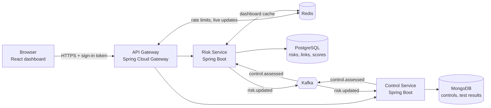
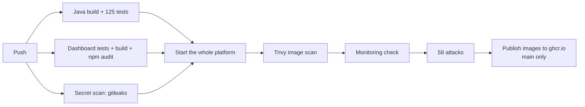

# Risk & Control Assessment Platform

**A working risk-management (GRC) system: when someone records that a security control has failed, every risk that depends on it is re-scored and the dashboard updates within about a second.**

Built as event-driven microservices with Java 25, Spring Boot, Kafka, PostgreSQL, MongoDB, Redis and React; deployed on Docker and Kubernetes; load-tested, penetration-tested and failure-tested, with every claim below backed by a test you can re-run.

[](https://github.com/SanyamKhaiwal/risk-control-platform/actions/workflows/ci.yml)
[](https://github.com/SanyamKhaiwal/risk-control-platform/actions/workflows/k8s.yml)

<!-- Demo video: added later -->

**Contents:** [What it is](#what-it-is) · [Results](#results-at-a-glance) · [How it works](#how-it-works) · [Tech stack](#tech-stack) · [Quick start](#quick-start) · [Using the app](#using-the-app) · [Testing and quality](#testing-and-quality) · [Kubernetes](#kubernetes) · [CI/CD](#cicd) · [Monitoring](#monitoring) · [Performance](#performance) · [Security](#security) · [For developers](#for-developers) · [Project structure](#project-structure) · [Documentation](#documentation) · [Limitations and roadmap](#limitations-and-roadmap)

---

## What it is

### The problem, in plain words

Banks and large companies keep a **risk register**: a list of things that could go wrong (a data leak, fraud, a system outage). Each risk is scored by **how likely** it is and **how bad** it would be.

To keep risks small, they put **controls** in place: multi-factor login, approvals, backups, alerting. Testers check regularly whether each control **actually works**. If a control fails its test, the risks it was protecting are bigger than the register says, and someone needs to know.

Enterprise tools (IBM OpenPages, RSA Archer, ServiceNow IRM) recalculate this in batches, and finding out *why* a score changed takes digging.

### What this platform does

1. A **risk owner** records a risk and scores it: likelihood × impact, each 1 to 5.
2. A **control owner** defines controls; the risk owner links them to the risks they protect.
3. A **tester** records whether a control works: *works*, *works partly* or *doesn't work*.
4. The platform **immediately recalculates** every affected risk, moves it on the heat-map, and records which test caused the change.

Every test result is **tamper-evident**: results are chained together with a keyed hash, so editing or deleting one directly in the database is detected.

### Who uses it

| Role | Demo user | What they do |
| --- | --- | --- |
| Risk owner | `alice` | Creates and scores risks, links controls to them |
| Control owner | `bob` | Defines controls |
| Control tester | `carol` | Tests controls and works through the re-test queue |
| Viewer (committee, auditor) | `dave` | Reads the register and heat-maps |
| Control owner + tester | `erin` | Shows segregation of duties: she still can't test her own controls |

All demo users have the password `demo123`. The data is synthetic demo data.

---

## Results at a glance

Every number was measured on a 4-core laptop (Intel i5-11300H) and can be reproduced with the commands in this README.

| Area | Result |
| --- | --- |
| Live updates | One Gateway (1 CPU, 512 MB) keeps **4,000 users live**, every change on screen in under a second. Polling the old way, the same laptop served 200 |
| Load on the backend | 4,000 live users cost the services about **2 requests a second** in total; with 4 Gateways, 400 viewers cost 1.2 |
| Security | **58 of 58** scripted attacks blocked (forged logins and events, data theft across users, injection, database tampering, XSS in a real browser) |
| Zero-downtime updates | Every Gateway replaced under load on Kubernetes: **0 failed requests** out of 9,744 |
| Failure recovery | A crashed service is back in **about 9 seconds**; no event lost while Kafka was down |
| Start-up time | **3.5× faster** with Java 25's ahead-of-time cache (26.7 s → 7.5 s) |
| Automated tests | **125 backend tests** against real databases, **24 dashboard tests**, run on every push |

---

## How it works

### The big picture



| Part | What it does |
| --- | --- |
| **Dashboard** (React) | The screens: heat-maps, the risk register, controls, the re-test queue. Gets changes pushed to it live |
| **API Gateway** | The single front door: checks sign-in tokens, limits request rates, routes requests, pushes live updates to open screens |
| **Risk Service** | Risks, their scores and links to controls (PostgreSQL) |
| **Control Service** | Controls and their test results, with the tamper-evident chain (MongoDB) |
| **Kafka** | Carries events between the two services, so neither has to call the other to stay in sync |
| **Redis** | Caches the dashboard, counts rate limits, and coordinates live updates across Gateways |

### What happens when a control fails its test

1. Carol records **"doesn't work"** for *MFA on admin accounts*.
2. The **Control Service** saves the result and a `control.assessed` event **in the same database transaction** (the *outbox pattern*), so the event can never be lost or sent for a result that wasn't saved.
3. The event is **signed** and sent to **Kafka**.
4. The **Risk Service** verifies the signature, finds every risk linked to that control, recalculates them, and records the new score with the event that caused it.
5. The dashboard cache is cleared, and the Gateway **pushes** the new heat-map to every open screen.

All of this takes about a second. Each service owns its own database; they only talk through the API and events.

### How scores are calculated

- **Risk before controls** = likelihood × impact (1 to 25).
- Each tested control counts as **1.0** (works), **0.5** (works partly) or **0** (doesn't work). Untested controls don't count, so linking a new control never makes a risk look worse.
- **Preventive** controls (they stop it happening) reduce **likelihood**; **detective** and **corrective** controls (they spot it or limit the damage) reduce **impact**.
- **Risk now** = reduced likelihood × reduced impact, each never below 1: controls shrink a risk, they never make it vanish.

| Rating | Score |
| --- | --- |
| Low | 1–5 |
| Medium | 6–11 |
| High | 12–19 |
| Critical | 20–25 |

**Worked example (the demo):** *Account takeover of privileged users* has likelihood 4 and impact 5, so it scores 20 (Critical) before controls. With *MFA on admin accounts* (preventive) working partly, likelihood drops to 2, so it scores 2 × 5 = 10 (Medium). When Carol records that MFA **doesn't work**, likelihood goes back to 4 and the risk jumps to **20, Critical**.

---

## Tech stack

| Layer | Technology | Why it's here |
| --- | --- | --- |
| Language | **Java 25** runtime (code targets Java 21 LTS) | Standard in bank backends; Java 25's ahead-of-time cache makes start-up 3.5× faster |
| Framework | **Spring Boot 4**, Spring Security, Spring Data | Web, data, security, Kafka and health checks in one stack |
| Gateway | **Spring Cloud Gateway** (reactive) | One entry point: auth, rate limits, routing, live updates over server-sent events |
| Databases | **PostgreSQL 17** (risks), **MongoDB 8** (controls, test results) | Relational data where it fits; append-only audit documents where they fit |
| Messaging | **Apache Kafka 4** (KRaft) | Durable, replayable events between services; transactional outbox; signed messages |
| Cache | **Redis 7.4** | Dashboard cache, rate limits, live-update coordination |
| Frontend | **React 19**, TypeScript, Vite, TanStack Query | Typed UI with live updates and a polling fallback |
| Security | RS256 JWT, Ed25519 event signatures, HMAC hash chain | Only the Gateway can issue tokens; forged events and tampered records are detected |
| Containers | **Docker**, Docker Compose (11 containers) | The whole platform with one command |
| Orchestration | **Kubernetes** (kind), HPA, network policies | Production-style deployment: HTTPS, autoscaling, zero-downtime updates |
| Monitoring | **Prometheus**, **Grafana**, **Tempo**, OpenTelemetry | Metrics, dashboards, alerts, and traces across REST and Kafka |
| Testing | JUnit 5, Testcontainers, Vitest, k6, Playwright | Real databases in tests, load tests, attacks in a real browser |
| Security tools | Trivy, gitleaks, OWASP ZAP, npm audit | Vulnerability, secret and web scanning |
| CI/CD | **GitHub Actions**, GitHub Container Registry, Dependabot | Every push built, tested, scanned, attacked and published |

---

## Quick start

### What you need

| Tool | Why | Get it |
| --- | --- | --- |
| **Git** | To download the code | [git-scm.com](https://git-scm.com) |
| **Docker Desktop** | Runs every part of the platform | [docker.com](https://www.docker.com/products/docker-desktop/) |
| **Node.js 22 or newer** | Runs the one-command start script | [nodejs.org](https://nodejs.org) (LTS) |

You don't need Java, Maven, a database, Kafka or Redis: all of them run inside Docker.

In Docker Desktop, open **Settings → Resources** and give it **at least 6 GB of memory**.

### Run it

```bash
git clone https://github.com/SanyamKhaiwal/risk-control-platform.git
cd risk-control-platform
node scripts/start.mjs
```

That one command:

1. starts Docker Desktop if it isn't running (Windows and macOS; on Linux, start Docker first),
2. creates a `.env` file with random passwords, and the security keys,
3. builds and starts all 11 containers in order, each waiting until the ones before it are healthy,
4. checks that everything answers,
5. loads demo data,
6. opens the dashboard at **http://localhost:5173**.

**The first run takes about 5 to 10 minutes** while everything is built from source. After that it starts in under a minute. Add `--no-open` to skip opening the browser, or `--no-seed` to start with an empty register.

### Stop, restart, reset

```bash
docker compose down        # stop (keeps your data)
node scripts/start.mjs     # start again
docker compose down -v     # stop and delete all data (fresh start next time)
```

### If something goes wrong

| Problem | Fix |
| --- | --- |
| "Docker is not running" or a `dockerDesktopLinuxEngine` pipe error | Open Docker Desktop, wait until it says it's running, run the command again |
| "Port is already allocated" | Another program uses 5173, 8080, 3000, 5432, 27017, 6379 or 9092. Close it, or stop the other app |
| Containers restart or the build is very slow | Give Docker more memory (Settings → Resources) |
| A container is unhealthy | `docker compose ps` shows which; `docker compose logs <name>` shows why, e.g. `docker compose logs risk-service` |

---

## Using the app

### Addresses

| What | Address | Sign-in |
| --- | --- | --- |
| **Dashboard** | http://localhost:5173 | `alice`, `bob`, `carol`, `dave` or `erin`, password `demo123` |
| API Gateway | http://localhost:8080 | a token from `/api/auth/login` |
| Grafana (monitoring) | http://localhost:3000 | opens read-only; admin password is `GRAFANA_ADMIN_PASSWORD` in `.env` |
| Prometheus | http://localhost:9090 | none |
| API docs (Swagger) | http://localhost:8081/swagger-ui.html, http://localhost:8082/swagger-ui.html | a token, via the *Authorize* button |

### The 30-second demo

1. Sign in as **carol** (the tester).
2. Open **Controls → MFA on admin accounts** and record **Doesn't work**.
3. Open the **Overview**: *Account takeover of privileged users* moves from **Medium 10** to **Critical 20** within about a second, and *SIEM alerting on privileged access* appears in the **re-test queue**.
4. Open the risk to see **why**: its score history names the control test that moved it.

Then try the rules: sign in as **dave** (viewer) and notice there's nothing to edit; sign in as **erin**, who owns and tests controls, and see that she can't test her own.

### Using the API directly

```bash
# Sign in to get a token
curl -s -X POST localhost:8080/api/auth/login -H "Content-Type: application/json" \
  -d '{"username": "alice", "password": "demo123"}'

# Use it
curl localhost:8080/api/risks -H "Authorization: Bearer <accessToken>"
```

The full API is listed in [docs/ARCHITECTURE.md §9](docs/ARCHITECTURE.md#9-api-v1). Errors follow RFC 7807 (`problem+json`).

---

## Testing and quality

Everything below runs automatically on every push (see [CI/CD](#cicd)), and each one can be run locally with the platform started:

| What | Command | What it proves |
| --- | --- | --- |
| Backend tests (125) | `./mvnw verify` | Scoring, APIs, roles, events, caching, against real PostgreSQL, MongoDB, Kafka and Redis (Testcontainers) |
| Dashboard tests (24) | `cd dashboard && npm test` | Screens, live updates, role-based actions |
| Attack suite (58) | `node security/attack-tests.mjs` | Forged tokens and Kafka events, role bypass, injection, database tampering, XSS in a browser |
| Monitoring check (10) | `node scripts/check-monitoring.mjs` | Metrics, traces, dashboards and alerts actually work |
| Security scans | `bash security/scan.sh` · `bash security/zap.sh` | Trivy, gitleaks, npm audit; OWASP ZAP against the UI and API |
| Load tests | `node load-tests/run.mjs` | Users, response times and limits on this machine (needs [k6](https://k6.io)) |
| Kubernetes checks | `node load-tests/k8s-checks.mjs` · `node load-tests/k8s-failures.mjs` | HTTPS, network policies, zero-downtime updates, crash recovery |

The browser check in the attack suite needs `playwright-core` (set `PLAYWRIGHT_CORE` to its folder) and Edge or Chrome; without it, that one check is reported as skipped.

---

## Kubernetes

Run the platform on a local Kubernetes cluster, set up the way a production cluster would be:

```bash
docker compose stop          # free memory first
node scripts/k8s.mjs         # about 5 minutes; then open https://localhost:8443
node scripts/k8s.mjs down    # delete the cluster
```

Needs [kind](https://kind.sigs.k8s.io) and [kubectl](https://kubernetes.io/docs/tasks/tools/) as well. The browser asks once about the self-signed certificate.

| Feature | How it's done | Tested result |
| --- | --- | --- |
| HTTPS | nginx edge with TLS and security headers; plain HTTP redirected | Verified on every deploy |
| Network isolation | Deny-all network policies; each database reachable only by its own service | A stray pod reaches **nothing** except the HTTPS edge (13/13) |
| Zero-downtime updates | Readiness probes, rolling updates that never drop below the ready count, graceful shutdown | **0 failed requests** while every Gateway was replaced |
| Autoscaling | Horizontal Pod Autoscaler: 2 to 4 Gateways on CPU | 2 → 4 Gateways in 63 s under load, 0 failed requests |
| Self-healing | Probes and restarts | Every part crashed under load and came back by itself; a failure never spread to the other service |
| Fast recovery | Java 25 ahead-of-time cache, CPU headroom at start-up | Crashed service back in about 9 s (was 40 to 56 s) |
| Hardened pods | Non-root, read-only file system, no privileges, Secrets for every key | Pod Security Standards (restricted for the app pods) |

Details, measurements and limits: [docs/kubernetes.md](docs/kubernetes.md).

---

## CI/CD

Every push and pull request runs [`ci.yml`](.github/workflows/ci.yml) on GitHub Actions:



1. **Build and test:** the Java services against real databases, the dashboard, and a secret scan over the whole git history, in parallel.
2. **Run and attack:** the whole platform is started with `node scripts/start.mjs`, exactly as above; the images are scanned (a fixable critical vulnerability fails the build); then the monitoring check and all 58 attacks run against it.
3. **Publish (main only):** the images that passed go to `ghcr.io/sanyamkhaiwal/rcp-{gateway,risk-service,control-service,dashboard}`, tagged with the commit.

[`k8s.yml`](.github/workflows/k8s.yml) also deploys every change on main to a fresh Kubernetes cluster and runs the Kubernetes checks. **Dependabot** opens weekly update pull requests, and each one goes through the same pipeline.

The pipeline earned its keep on its first runs: it caught a cache that could briefly show old heat-map counts, key files the containers couldn't read on Linux, and MongoDB 8 refusing to start on the runners' newer Linux kernel ([SERVER-121912](https://jira.mongodb.org/browse/SERVER-121912); CI uses MongoDB 7.0, everything else 8.0).

---

## Monitoring

| What | Where |
| --- | --- |
| Dashboards (platform overview, events, security) | Grafana, http://localhost:3000 |
| Metrics and alert rules | Prometheus, http://localhost:9090 |
| Traces | Grafana → *Explore* → *Tempo*: one control test is one trace across the Gateway, both services and Kafka |
| Logs | Structured JSON (ECS) from every service: `docker compose logs <name>` |

Health and metrics are on a separate management port that isn't published, so the public API never exposes them. Details: [docs/monitoring.md](docs/monitoring.md).

---

## Performance

The headline result came from an optimisation, not more hardware: screens get changes **pushed** over one open connection instead of asking every few seconds.

| | Polling (before) | Push (now) |
| --- | --- | --- |
| Users one laptop serves | 200 | **4,000** |
| Requests the services answer | grows with every user | about **2 a second**, whatever the number of users |
| Overview screen, p95 response | 801 ms (several requests) | **21 ms** (one request) |

Other measured changes: list caches halved database work; a fan-out fix cut Gateway CPU from 101% to 85%; a shared live-update hub keeps backend load flat however many Gateways run. Estimates up to 1,000,000 users, and how they were derived: [docs/performance.md](docs/performance.md).

```bash
node load-tests/run.mjs                 # load test sized to this machine (needs k6)
node load-tests/run.mjs --live 1000,4000  # the live-update test
```

---

## Security

The platform was penetration-tested by its author and by an independent reviewer, and scanned with Trivy, gitleaks, npm audit and OWASP ZAP. Every finding, its fix or the reason it was accepted, is in [docs/security-review.md](docs/security-review.md).

| Protection | How |
| --- | --- |
| Sign-in tokens | RS256: only the Gateway holds the private key; services can verify tokens but never create them |
| Roles and ownership | Checked on every request; owners and testers always come from the token, never from the request |
| Segregation of duties | A tester can't test a control they own, even with both roles |
| Brute force | 10 sign-ins per username and 30 per address per minute; identical answers and timing for unknown users |
| Forged events | Every Kafka event is signed (Ed25519); unsigned or altered events are rejected |
| Tampering | Test results are append-only and chained with a keyed hash; `/verify` reports the first broken record |
| Abuse | Per-user rate limits, 256 KB request limit, strict CSP and security headers, HTTPS on Kubernetes |
| Secrets | Generated per machine, git-ignored, never baked into images; Kubernetes Secrets in the cluster |

---

## For developers

To work on the Java services you also need **Java 21 or newer** (Temurin). Maven isn't needed: the repo ships the Maven wrapper (`./mvnw`, or `mvnw.cmd` on Windows).

```bash
docker compose up -d --wait postgres mongo kafka redis   # just the infrastructure
./mvnw verify                                            # build and test everything

./mvnw -pl risk-service spring-boot:run      # http://localhost:8081
./mvnw -pl control-service spring-boot:run   # http://localhost:8082
./mvnw -pl gateway spring-boot:run           # http://localhost:8080

cd dashboard && npm install && npm run dev   # http://localhost:5173
node scripts/seed-demo.mjs                   # demo data, from the repo root
```

The same steps as the start script, by hand:

```bash
cp .env.example .env                 # then replace every change-me
node scripts/gen-dev-keys.mjs        # keys in deploy/keys/ (git-ignored)
docker compose up -d --build --wait
node scripts/seed-demo.mjs
```

Ports, environment variables and profiles: [docs/ARCHITECTURE.md §17](docs/ARCHITECTURE.md#17-configuration-ports-and-prerequisites).

---

## Project structure

| Path | What it is |
| --- | --- |
| `risk-service/` | Risks, scoring, links (Spring Boot, PostgreSQL) |
| `control-service/` | Controls and test results with the hash chain (Spring Boot, MongoDB) |
| `gateway/` | Sign-in, routing, rate limits, live updates (Spring Cloud Gateway) |
| `dashboard/` | React UI |
| `compose.yaml` | The whole platform in Docker, monitoring included |
| `deploy/docker/` | Dockerfiles and the nginx config |
| `deploy/k8s/` | Kubernetes manifests: workloads, network policies, HTTPS edge |
| `deploy/monitoring/` | Prometheus, alert rules, Tempo, Grafana dashboards |
| `scripts/` | One-command start, Kubernetes setup, demo data, dev keys, monitoring check |
| `load-tests/` | k6 load tests, live-update test, Kubernetes checks and failure tests |
| `security/` | Attack suite, scanners, OWASP ZAP, a throwaway stack for destructive tests |
| `.github/` | CI/CD workflows and Dependabot |
| `docs/` | Architecture, performance, security, monitoring and Kubernetes write-ups |

---

## Documentation

| Document | What's in it |
| --- | --- |
| [ARCHITECTURE.md](docs/ARCHITECTURE.md) | Design, data model, events, API, security model, design decisions |
| [performance.md](docs/performance.md) | Load-test results, the bottleneck hunt, optimisations, estimates to 1M users |
| [security-review.md](docs/security-review.md) | Penetration test and scan findings, fixes and accepted risks |
| [kubernetes.md](docs/kubernetes.md) | Cluster setup, test results, failure tests, faster restarts |
| [monitoring.md](docs/monitoring.md) | Metrics, traces, dashboards, alerts |

---

## Limitations and roadmap

Honest limits of what's here:

- **One copy of each service.** Each service sends its events from a single publisher, so a service restart means about 9 to 13 seconds when its screens are unavailable. Running two copies needs an elected publisher; that's the next step.
- **Single-machine tests.** Throughput was measured on one laptop and Kubernetes runs on one node; the large-scale numbers are estimates, with their method shown.
- **Kafka has no login.** Network policies limit who can reach it and every event is signed, but SASL/TLS with access lists is still to do.
- **Demo sign-in.** Seeded users, no single sign-on, and tokens can't be revoked before they expire (30 minutes).

On the roadmap: multiple service copies with an elected outbox publisher, single sign-on (OIDC), anchoring the hash chain outside the database, multi-tenancy, approvals workflows and evidence attachments.
