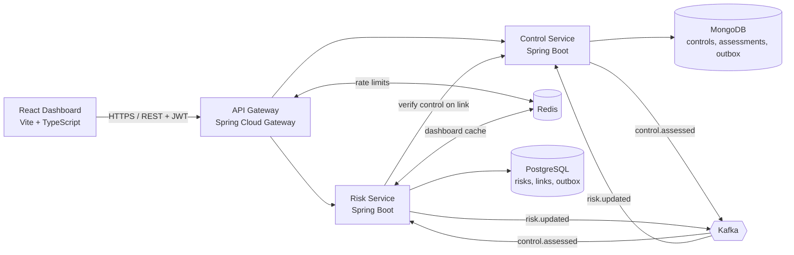

# Risk & Control Assessment Platform — Architecture

> Status: design, v0.2 (28 Oct 2026). Owner: Sanyam Khaiwal.
>
> v0.2 changes: residual likelihood/impact so the residual heat-map moves when a control fails; integer scoring with gap-free rating bands; Risk Service owns risk-to-control links and keeps a local effectiveness projection; transactional outbox in v1; four roles and seeded demo users; RS256 everywhere; hash-chained assessments; cache key and eviction fixes; no hard deletes; build plan re-estimated.

## 1. What this project is

A small **GRC (Governance, Risk & Compliance)** platform. Banks and large companies keep a **risk register**: a list of things that could go wrong (fraud, data leak, system outage), each scored by how likely it is and how bad it would be. Against each risk they put **controls** (MFA, approvals, backups) and regularly **assess** whether those controls work. Tools like IBM OpenPages, RSA Archer and ServiceNow IRM do this at enterprise scale.

This project builds a working, cut-down version of that:

1. A **risk owner** records a risk and scores it (likelihood × impact).
2. A **control owner** defines controls; the risk owner links them to the risk.
3. A **tester** assesses each control (effective / partially effective / ineffective).
4. The platform automatically recalculates the risk's **residual likelihood, impact and score**, and the residual heat-map updates.

## 2. Scope

**In scope (v1):** risk register CRUD and scoring; controls and control-to-risk links; control assessments with a hash-chained audit history; automatic residual recalculation through Kafka with a transactional outbox; Redis-cached dashboard; React UI with inherent and residual heat-maps; JWT login with four roles and seeded demo users; Docker Compose for local dev; Kubernetes manifests; CI/CD; health and metrics; demo seed script.

**Out of scope (v1):** multi-tenancy, workflow approvals, file attachments, email notifications, real SSO, refresh tokens, control retirement, horizontal scaling of the outbox publishers. Listed in the roadmap (§21).

## 3. High-level architecture



**Request path:** React → Gateway (validates JWT, rate-limits, routes) → service → its own database.

**Event path:** the Control Service saves an assessment and its `control.assessed` event in one transaction (outbox). A publisher sends the event to Kafka. The Risk Service consumes it, updates its copy of that control's effectiveness on every linked risk, recalculates them, and in the same transaction writes score history and a `risk.updated` outbox event. After commit, the dashboard cache is evicted.

Each service **owns its data**. No service reads another service's database; they talk only through REST or events.

## 4. Components

### 4.1 Risk Service (Java 21, Spring Boot)
- **Owns:** risks, scores, score history, **risk-to-control links** (the single source of truth for links) and a local projection of each linked control's type and latest effectiveness.
- **Database:** PostgreSQL. Risks and links are relational data with strong consistency needs.
- **Does:** CRUD on risks; link/unlink controls (verifying the control with the Control Service); calculates inherent and residual scores (§6); serves dashboard summaries (cached in Redis); consumes `control.assessed`; publishes `risk.updated` via its outbox.

### 4.2 Control Service (Java 21, Spring Boot)
- **Owns:** controls, assessments, the hash-chained assessment audit log, re-test flags.
- **Database:** MongoDB (single-node replica set, required for multi-document transactions). Assessments are append-only documents whose shape varies by control type (evidence, test steps, comments), which fits a document store.
- **Does:** CRUD on controls; records assessments (enforcing segregation of duties); publishes `control.assessed` via its outbox; consumes `risk.updated` to flag stale controls on worsening risks for re-testing. It does **not** store which risks a control is linked to.

### 4.3 API Gateway (Spring Cloud Gateway)
Single entry point for the UI: login and token issuing, routing, JWT validation, CORS, per-user rate limiting (backed by Redis).

### 4.4 React Dashboard (React 19, TypeScript, Vite)
- **Risk register** table with filters (status, owner, rating).
- **Heat-maps**: two 5×5 grids side by side, **inherent** (likelihood × impact) and **residual** (residual likelihood × residual impact), cells tinted by rating band with counts per cell; clicking a cell lists the risks in it. Live screens poll the cached endpoints every 2 s; when a figure changes, the old value is struck through in red and the new one posted beside it (the UI's one signature motion). Visual system: [DESIGN.md](../DESIGN.md); product context: [PRODUCT.md](../PRODUCT.md).
- **Risk detail**: linked controls with type and effectiveness (from the Risk Service), latest assessment per control (from the Control Service), score history.
- **Assess control** form and a **re-test queue** (controls flagged for re-testing).

### 4.5 Kafka (event bus)
Decouples the services: the Control Service doesn't know the Risk Service exists. If a consumer is down, events wait in Kafka and are processed on restart; the outbox (§8.2) covers the producer side. Kafka also absorbs bursts of assessments and lets state be rebuilt by replaying topics. See §20 for why Kafka is worth it with only two services.

### 4.6 Redis (cache)
Caches the expensive dashboard queries (heat-map counts, top risks). Entries are evicted after every committed risk write, with a short TTL as a safety net. Also backs gateway rate limiting.

## 5. Technology choices and what each is for

**Pinned in step 1 (28 Oct 2026):** Spring Boot 4.0.9, Spring Cloud 2025.1.4, Maven 3.9.16 (via the wrapper), `postgres:17.11`, `mongo:8.0.34`, `apache/kafka:4.3.2`, `redis:7.4.12`. Boot stays on 4.0.x because Spring Cloud has no GA release train for Boot 4.1 yet (2026.0 is at RC). Library versions added later (springdoc, etc.) are pinned in the step that introduces them.

| Technology | Used for | Why this and not something else |
| --- | --- | --- |
| **Java 21 (LTS)** | Both backend services | Main language in bank backends; records, virtual threads |
| **Spring Boot 4.0** | Service framework | Industry standard: web, data, security, Kafka, actuator in one stack. Fall back to 3.5.x only if a library blocks |
| **Spring Data JPA** | Risk Service persistence | Maps risks to PostgreSQL tables with little boilerplate |
| **Spring Data MongoDB** | Control Service persistence | Natural fit for flexible assessment documents; supports transactions on a replica set |
| **PostgreSQL 17** | Risk data, links, outbox | Relational, ACID, good for scoring queries and reporting |
| **MongoDB 8** | Controls and assessment audit log | Schema-flexible, append-heavy audit data |
| **Apache Kafka 4 (KRaft)** | Events between services | Durable, replayable, decouples services |
| **Redis 7.4+** | Dashboard cache, rate limiting | In-memory speed for read-heavy dashboard |
| **Spring Security + JWT (RS256)** | Login and role-based access | Stateless auth; only the gateway can sign, services only verify |
| **Spring Cloud Gateway** | Single API entry point | Routing, auth check and rate limiting in one place |
| **React 19 + TypeScript + Vite** | Dashboard UI | Typed, fast dev server, widely used |
| **Flyway** | PostgreSQL schema migrations | Versioned, repeatable schema changes |
| **Docker / Docker Compose** | Local run of all 8 containers | One command to start everything |
| **Kubernetes (kind)** | Deployment manifests | Shows production-style deployment on a laptop |
| **GitHub Actions** | CI: build, test, image | Free, runs on every push / PR |
| **Jenkinsfile** | Same pipeline for Jenkins | Verified by running it once in a local Jenkins container |
| **JUnit 5, Mockito, Testcontainers** | Unit and integration tests | Testcontainers runs real Postgres/Mongo/Kafka/Redis in tests |
| **Spring Boot Actuator + Micrometer** | Health and metrics | `/actuator/health`, Prometheus metrics |
| **Prometheus + Grafana** (optional) | Monitoring dashboards | Monitoring and alerting |
| **OpenAPI (springdoc)** | API documentation | Auto-generated Swagger UI per service |
| **k6** | Load tests | Scriptable, produces latency percentiles |

## 6. Scoring model

All scores are integers, so rating bands have no gaps and no rounding ambiguity in stored values.

**Inherent:** `inherent_score = likelihood × impact`, each 1–5, so 1–25.

**Control effectiveness** comes from the control's latest assessment: EFFECTIVE = 1.0, PARTIALLY_EFFECTIVE = 0.5, INEFFECTIVE = 0.0. The value is derived by the server from the result, never sent by the client.

**What each control type reduces:**
- **PREVENTIVE** controls reduce **likelihood**.
- **DETECTIVE** and **CORRECTIVE** controls reduce **impact**.

**Aggregation per risk:**
- `E_L` = average effectiveness of the risk's linked, **tested** preventive controls.
- `E_I` = average effectiveness of the risk's linked, **tested** detective/corrective controls.
- Untested controls (no assessment yet) are excluded, so linking a new control never makes a risk worse.
- A group with no tested controls has effectiveness 0 (no reduction). A risk with no controls has residual = inherent.

**Residual:**
- `residual_likelihood = max(1, roundHalfUp(likelihood × (1 − E_L)))`
- `residual_impact = max(1, roundHalfUp(impact × (1 − E_I)))`
- `residual_score = residual_likelihood × residual_impact`

The floor of 1 means controls can reduce a risk but never make it disappear.

**Rating bands** (applied to both inherent and residual scores):

| Rating | Score |
| --- | --- |
| LOW | 1–5 |
| MEDIUM | 6–11 |
| HIGH | 12–19 |
| CRITICAL | 20–25 |

**Worked example (the demo):** "Account takeover", likelihood 4, impact 5 → inherent 20 CRITICAL. Linked: "MFA on admin accounts" (PREVENTIVE, PARTIALLY_EFFECTIVE) and "SIEM alerting" (DETECTIVE, untested).
- `E_L = 0.5` → residual likelihood `round(4 × 0.5) = 2`; `E_I = 0` → residual impact 5 → residual 10 MEDIUM, cell (2,5).
- The tester marks MFA INEFFECTIVE → `E_L = 0` → residual likelihood 4 → residual 20 CRITICAL. The risk jumps from (2,5) to (4,5) on the residual heat-map.

The scoring engine is a pure function (`ScoringEngine.score(risk, links)`) with no I/O, so it is fully unit-tested.

## 7. Data model

All ids are UUIDs, stored as `uuid` in PostgreSQL and as strings in MongoDB.

### 7.1 Risk Service (PostgreSQL)

**`risk`**

| Column | Type | Notes |
| --- | --- | --- |
| id | uuid PK | |
| title | varchar(200) | |
| description | text | |
| category | enum | OPERATIONAL, CYBER, FRAUD, COMPLIANCE, FINANCIAL, THIRD_PARTY |
| owner | varchar(64) | user id (JWT `sub`) |
| likelihood | int 1–5 | |
| impact | int 1–5 | |
| inherent_score | int 1–25 | likelihood × impact |
| residual_likelihood | int 1–5 | §6 |
| residual_impact | int 1–5 | §6 |
| residual_score | int 1–25 | residual_likelihood × residual_impact |
| rating | enum | LOW, MEDIUM, HIGH, CRITICAL on residual_score |
| status | enum | OPEN, MITIGATED, ACCEPTED, CLOSED |
| version | int | optimistic locking |
| created_at, updated_at | timestamptz | |

Risks are never hard-deleted; they are moved to CLOSED. Closed risks are excluded from the dashboard.

**`risk_control_link`**: the link and the local effectiveness projection

| Column | Type | Notes |
| --- | --- | --- |
| risk_id | uuid FK | PK part |
| control_id | uuid | PK part; indexed |
| control_type | enum | PREVENTIVE, DETECTIVE, CORRECTIVE (copied at link time; type is immutable) |
| latest_effectiveness | numeric(3,2) null | null = untested |
| last_assessed_at | timestamptz null | out-of-order guard (§8.4) |
| linked_at | timestamptz | |

**`risk_score_history`**: `id, risk_id, inherent_score, residual_score, rating, cause (CREATED, EDITED, LINKED, UNLINKED, ASSESSMENT), cause_event_id null, cause_control_id null, changed_at`. `cause_control_id` (migration V2) names the control whose link, unlink or test moved the score, so the UI can say "Call-back check was tested: score rose 5 → 20". A row is written on creation and whenever a score or rating changes, so linking an untested control or editing only the title adds no row.

Enums are stored as `varchar` with CHECK constraints, and Hibernate runs with `ddl-auto: validate` so the entities must match the Flyway schema.

**`outbox`**: `id (= eventId), topic, msg_key, payload jsonb, created_at, published_at null`; partial index on `published_at IS NULL`.

**`processed_event`**: `event_id PK, topic, processed_at`.

### 7.2 Control Service (MongoDB)

**`controls`**

```json
{ "_id": "8f1c…", "name": "MFA on admin accounts", "description": "…",
  "type": "PREVENTIVE", "owner": "bob", "frequency": "QUARTERLY",
  "latestResult": "PARTIALLY_EFFECTIVE", "latestEffectiveness": 0.5,
  "lastAssessedAt": "2026-10-28T10:00:00Z", "lastAssessmentHash": "ab34…", "assessmentCount": 3,
  "retestRequired": false, "retestReason": null, "version": 3 }
```

`type` cannot change after creation, so the Risk Service's copy of it never goes stale.

**`assessments`** (append-only, hash-chained; unique index on `controlId, sequence`)

```json
{ "_id": "c27e…", "controlId": "8f1c…", "sequence": 3, "result": "PARTIALLY_EFFECTIVE",
  "effectiveness": 0.5, "tester": "carol", "evidence": "…", "comments": "…",
  "assessedAt": "2026-10-28T10:00:00Z",
  "prevHash": "0000…", "hash": "ab34…" }
```

- `assessedAt` is set by the server.
- `sequence` numbers a control's assessments 1, 2, 3…; the control's `assessmentCount` and `lastAssessmentHash` are the chain head.
- `hash = HMAC-SHA256`, keyed with a secret only the Control Service holds (`deploy/keys/assessment-chain.key`, never in MongoDB), over `controlId, sequence, result, effectiveness, tester, evidence, comments, assessedAt, prevHash`, each written as `<utf-8 length>:<value>;` (null as `-:;`), so a value can't be moved into a neighbouring field without changing the hash. `assessedAt` is truncated to milliseconds (MongoDB's precision) before hashing. The first assessment of a control uses 64 zeros as `prevHash`. The key is what makes the chain tamper-evident: with a plain SHA-256, anyone who could write to MongoDB could edit a record and recompute every hash (found in the security review). Moving existing chains to a new key is a one-time, operator-only step (`CONTROL_ASSESSMENTS_RESEAL=true` for one start).
- Recording an assessment runs in one MongoDB transaction: insert the assessment, update the control (`latest*`, chain head, clear `retestRequired`, bump `version`) and, from step 5, insert the outbox event. Two concurrent assessments of the same control conflict (write conflict, version check or the unique index); the loser retries with jittered backoff (up to 10 attempts), so the chain stays linear.
- `/verify` reports a sequence gap (deleted from the middle), a `prevHash` mismatch, content that no longer matches its hash (edited), or a chain head that doesn't match the control (deleted from the end).

**`outbox`** and **`processed_events`** collections mirror the PostgreSQL tables.

## 8. Events and reliability

### 8.1 Topics

| Topic | Key | Producer | Consumer | Payload |
| --- | --- | --- | --- | --- |
| `control.assessed` | controlId | Control Service | Risk Service | `{ eventId, schemaVersion, controlId, controlType, assessmentId, result, effectiveness, assessedAt }` |
| `risk.updated` | riskId | Risk Service | Control Service | `{ eventId, schemaVersion, riskId, cause, inherentScore, residualScore, rating, previousRating, controlIds[], updatedAt }` |

`schemaVersion` starts at 1; consumers reject unknown major versions to the dead-letter topic. Topics are created by the services (3 partitions each) and broker auto-create is off. Payloads are JSON strings; consumers ignore unknown fields, so adding a field is not a breaking change. From step 12 the correlation id travels in a Kafka header.

`risk.updated` is emitted on create, every edit, every status change, and on link, unlink or assessment when the score actually changes. Its `status` field lets the Control Service ignore closed risks. The UI does not read Kafka; it polls the cached dashboard endpoints.

### 8.2 Transactional outbox (both services)

The data change and its event are written in **one database transaction**, so a crash can never save data without its event, or the reverse.

- **Signed events.** The event is signed when its outbox row is written, inside the same transaction, with the sending service's Ed25519 private key; the signature is stored with the row (the Risk Service's `payload` column is `text`, not `jsonb`, so the signed bytes come back unchanged) and sent as the `rcp-signature` Kafka header. Each consumer accepts only events signed by the other service's key and sends anything else to the dead-letter topic with a `SECURITY` log line. A process that can write to a topic, or insert an outbox row without the key, can't change a score. Each service holds only its own private key and the other's public key.
- A publisher (`@Scheduled`, every 500 ms, batches of 100) reads unpublished rows in `created_at` order, sends each to Kafka with its key and signature, and marks it published after the broker acknowledges.
- A crash after sending but before marking causes a re-send; consumers are idempotent (§8.3), so this is safe.
- v1 runs one replica per service so a single publisher preserves order. Scaling out (row claiming with `FOR UPDATE SKIP LOCKED`, or CDC with Debezium) is on the roadmap.

### 8.3 Idempotent consumers

Every event has an `eventId`. The consumer inserts it into `processed_event` **in the same transaction** as the change it makes. If the id already exists, the event is skipped. Kafka's at-least-once delivery and outbox re-sends therefore never double-apply a change.

### 8.4 Ordering and concurrency

- `control.assessed` is keyed by `controlId`, so assessments of one control are processed in order within a partition.
- **Out-of-order guard:** a retried or replayed old event must not overwrite newer data. The Risk Service updates a link's `latest_effectiveness` only if the event's `assessedAt` is later than `last_assessed_at`; otherwise it records the event as processed and does nothing.
- **Concurrent updates to one risk:** two controls of the same risk can be assessed at once and processed on different partitions. Optimistic locking (`version`) makes one transaction fail; `OptimisticLockingFailureException` is retryable, so it is retried and recalculates from fresh data.

### 8.5 Retries and dead-letter topics

Spring Kafka `DefaultErrorHandler` with exponential backoff (1 s, 2 s, 4 s), then `DeadLetterPublishingRecoverer` to `<topic>.DLT`. Deserialization and validation errors are not retryable and go straight to the DLT. DLT messages can be inspected and replayed manually.

### 8.6 Consumer behaviour

**Risk Service on `control.assessed`** (one transaction):
1. Skip if `eventId` is already processed.
2. Find all links with that `control_id`; update `latest_effectiveness` / `last_assessed_at` where the event is newer.
3. Recalculate each affected risk (§6), write `risk_score_history` with `cause_event_id`, write a `risk.updated` outbox row.
4. Insert into `processed_event`.
5. After commit: evict dashboard caches (§11).

**Control Service on `risk.updated`**: when `rating` is HIGH or CRITICAL **and** higher than `previousRating`, set `retestRequired = true` on every control in `controlIds` that hasn't been assessed in the last 30 days (or ever). A new risk (no `previousRating`) counts as worsening, closed risks never do, and 30 days is the `control.retest.stale-after` setting. The update bumps each control's `version`, so a concurrent edit based on an older read fails instead of silently clearing the flag. The control whose assessment caused the change was just assessed, so it is not flagged. This consumer writes no events, so there is no event loop.

## 9. API (v1)

Errors use RFC 7807 problem+json. Every service exposes Swagger UI at `/swagger-ui.html`. Updates carry `version`; a stale version returns `409 Conflict`.

**Risk Service**
- `GET /api/risks?status=&rating=&owner=&controlId=&page=&size=`: list. `controlId` answers "which risks use this control?"
- `POST /api/risks`: create.
- `GET /api/risks/{id}` · `PUT /api/risks/{id}`: read, edit (title, description, category, likelihood, impact).
- `PATCH /api/risks/{id}/status`: change status (no DELETE endpoint).
- `GET /api/risks/{id}/controls`: links with type and latest effectiveness.
- `POST /api/risks/{id}/controls/{controlId}`: link. The Risk Service calls `GET /api/controls/{controlId}` on the Control Service (forwarding the caller's JWT) to check that the control exists and copy its type, latest effectiveness and `lastAssessedAt`.
- `DELETE /api/risks/{id}/controls/{controlId}`: unlink (removes the link, not the risk).
- `GET /api/risks/{id}/history`: score history.
- `GET /api/dashboard/heatmap`: `{ inherent: 5×5 counts, residual: 5×5 counts }`, excluding CLOSED (cached).
- `GET /api/dashboard/top?limit=10`: highest residual risks, `limit` 1–50 (cached).

**Control Service**
- `GET /api/controls?type=&owner=&retestRequired=` · `POST /api/controls`.
- `GET /api/controls/{id}` · `PUT /api/controls/{id}`: edit name, description, owner, frequency (`type` is immutable).
- `POST /api/controls/{id}/assessments`: record an assessment (body: result, evidence, comments). Emits `control.assessed`.
- `GET /api/controls/{id}/assessments`: audit history.
- `GET /api/controls/{id}/assessments/verify`: recomputes the hash chain → `{ valid, checked, firstBrokenAssessmentId }`.

**Gateway**
- `POST /api/auth/login` → `{ accessToken, expiresIn }`.

## 10. Security

**Authentication**
- Login happens at the gateway against **seeded demo users** (bcrypt hashes loaded from config / env / k8s Secret). Real SSO is out of scope. An unknown username and a wrong password get the same 401, and take the same time (bcrypt runs against a dummy hash), so usernames can't be discovered. Login attempts are limited to 10 per username and 30 per client address per minute (Redis), then 429; the address limit stops one password being sprayed across many usernames.
- JWTs are **RS256 in every environment**: the gateway signs with a private key; services only hold the public key (Spring Security resource server, `public-key-location`), so no service can mint tokens. A script (`node scripts/gen-dev-keys.mjs`) creates the dev key pair in git-ignored `deploy/keys/`; in k8s the keys come from Secrets.
- Tokens last 30 minutes; no refresh tokens in v1.
- The gateway validates the token (rejects early) and each service validates it again. Service-to-service calls forward the caller's token.

**Roles** (enforced with `@PreAuthorize`; every role can read)

| Role | Can |
| --- | --- |
| `RISK_OWNER` | Create risks; edit, link/unlink and change status of **risks they own** |
| `CONTROL_OWNER` | Create controls (the creator is the owner); edit **controls they own** |
| `CONTROL_TESTER` | Record assessments |
| `VIEWER` | Read only |

**Segregation of duties:** a tester cannot assess a control they own (`control.owner == jwt.sub` → 403).

**Seeded users** (password `demo123`, local development only): `alice` (RISK_OWNER), `bob` (CONTROL_OWNER), `carol` (CONTROL_TESTER), `dave` (VIEWER), `erin` (CONTROL_OWNER + CONTROL_TESTER, to show that holding both roles still doesn't let her assess her own controls).

**Identity always comes from the token:** a risk's or control's owner and an assessment's tester are the JWT `sub`, never a request field.

**Other rules**
- Input validation with Bean Validation; parameterised queries only.
- Secrets from environment variables / k8s Secrets, never committed; `.env.example` is committed.
- Per-user rate limiting at the gateway (Redis token bucket, 20 req/s, burst 40), keyed by JWT `sub`, falling back to client IP; over the limit returns 429.
- Request bodies are capped at 256 KB: the gateway answers 413 (411 for a body without a length) before routing, and each service enforces the same cap itself, so a huge body can't exhaust a service's memory.
- A service that is down or drops a request gives 503 / 502 / 504 from the gateway, not 500.
- CORS: only the UI origin (`CORS_ALLOWED_ORIGINS`, default `http://localhost:5173`) may call the API from a browser.
- Swagger UI on each service has an "Authorize" button for pasting a token from `/api/auth/login`.
- **Security review:** penetration test, Trivy, gitleaks, npm audit and OWASP ZAP results, with each finding's fix or reason for acceptance, are in [security-review.md](security-review.md); `security/attack-tests.mjs` re-runs the 51 attacks.
- **Tamper evidence:** assessments are append-only (no update/delete endpoint) **and** hash-chained per control (§7.2), so editing or deleting an assessment directly in the database breaks the chain, and `/verify` reports where. The hash is keyed (HMAC), so someone who can write to MongoDB can't recompute a consistent chain. Limitation: deleting the newest records and rolling the head back to an earlier genuine state is not detected; anchoring the head hash externally is on the roadmap.
- **Data stores and events behind the gateway:** MongoDB and Redis require credentials (PostgreSQL already did); Kafka events are signed (§8.2), so a message written straight to a topic is rejected.

## 11. Caching strategy (Redis)

| Cache / key | Content | TTL | Evicted when |
| --- | --- | --- | --- |
| `dashHeatmap` → `dashHeatmap::all` | inherent + residual 5×5 counts | 5 min | any committed risk write |
| `dashTop` → `dashTop::{limit}` | top residual risks for that limit | 5 min | any committed risk write (all entries) |
| `risk` → `risk:{id}` | single risk DTO | 10 min | that risk changes |

- A "risk write" is anything that changes a risk's scores or status: create, edit, status change, link, unlink, and recalculation from `control.assessed`.
- Implemented with Spring Cache (`@Cacheable`; eviction in a `@TransactionalEventListener(phase = AFTER_COMMIT)`), so the cache is only cleared once the new data is visible. A read that raced the commit can still cache old data briefly; the TTL bounds that.
- Values are stored as plain JSON, one DTO type per cache, so `redis-cli get dashHeatmap::all` is readable.
- If Redis is down, cache errors are logged and reads fall through to PostgreSQL; a failed eviction after commit is logged, never returned to the client.
- During an assessment burst the dashboard cache is evicted constantly, so cache gains are measured with the read-only load test (§16). Before/after numbers go in the README.

## 12. Running it

**Local (Docker Compose):** `compose.yaml` at the repo root, so `docker compose up -d --wait` works from the root and reads the root `.env`. It starts 8 containers: postgres, mongo (single-node replica set, initiated by its healthcheck), kafka, redis, risk-service, control-service, gateway, dashboard. `docker compose up -d --build --wait` starts all 8 in dependency order (infrastructure, then Control Service, Risk Service, Gateway, dashboard), each gated on a health check. Images: the three Java services share one two-stage Dockerfile (`deploy/docker/java-service.Dockerfile`, JDK build → JRE run, layered jar, non-root user, heap sized from the container limit); the dashboard is built with Node and served by an unprivileged nginx with security headers (CSP, frame and content-type protection). JWT keys are mounted read-only at run time, never baked into an image. Every container has CPU and memory limits (≈7.75 CPUs, ≈5 GB in total) so load tests run against a known budget. Kafka, PostgreSQL and MongoDB keep their data on named volumes. Ports bind to loopback only (127.0.0.1 and ::1; Windows tries ::1 first for "localhost"). Containers reach MongoDB with `?replicaSet=rs0` and Kafka on `kafka:29092`; services run on the host use `?directConnection=true` and `localhost:9092`. Prometheus and Grafana are an optional Compose profile (`--profile monitoring`).

**Demo data:** `node scripts/seed-demo.mjs` logs in as the seeded users and creates risks, controls, links and assessments **through the gateway**, so all seed data flows through the real events and the dashboard is populated for the demo.

**Kubernetes (kind):** one Deployment + Service per app (1 replica each, §8.2); StatefulSets for Postgres/Mongo/Kafka (dev-grade); ConfigMaps and Secrets for config and JWT keys; an Ingress routing `/api` to the gateway and `/` to the UI; readiness/liveness probes on `/actuator/health`. *As built (docs/kubernetes.md):* an nginx edge Deployment instead of an Ingress (ingress-nginx is retired), TLS there, network policies, and 2–4 autoscaled Gateways (the live hub and local rate limits made them stateless).

## 13. CI/CD

GitHub Actions on every push and PR:
1. Build and unit-test each service (Maven) and the UI (npm).
2. Integration tests with Testcontainers.
3. Build Docker images; on `main`, push to GitHub Container Registry.
4. Branch protection: merge only when checks pass.

A `Jenkinsfile` mirrors the same stages. It is verified by running it once in a local Jenkins container, with the steps recorded in the README.

## 14. Observability

Details, dashboards and how to try it: [monitoring.md](monitoring.md).

- **Probes and metrics on a separate management port** (9091, not published): health, readiness and liveness for Docker and k8s; `/actuator/prometheus` for Prometheus. The API ports never serve them.
- **Metrics** (Micrometer → Prometheus, every 5 s): request rate, latency histograms, errors, JVM, Kafka consumer lag, cache hits, and the platform's own: test-to-rescore time, events consumed by outcome (including rejected signatures), outbox backlog and publishes, tests recorded, sign-ins by outcome. Counters start at 0 so their first rise is visible.
- **Traces** (Micrometer Tracing → OpenTelemetry → Tempo): W3C trace context through the Gateway, REST and Kafka. The outbox stores the writing request's `traceparent`, and the publisher sends inside a span continuing it, so a control test is one trace across both services. Security-filter and scheduler observations are off (noise).
- **Logs**: JSON (ECS) in Docker, with `traceId`/`spanId`; Kafka clients at WARN.
- **Grafana** dashboards (overview, events, security) and **Prometheus alert rules** provisioned from `deploy/monitoring/`.

## 15. Testing

| Level | Tooling | Examples |
| --- | --- | --- |
| Unit | JUnit 5, Mockito | scoring engine: worked example, rounding, floor of 1, untested excluded, band edges (5/6, 11/12, 19/20); hash computation; SoD rule |
| Integration | Testcontainers | REST → Postgres round trip; outbox row written in the same transaction; duplicate event is ignored; out-of-order event doesn't overwrite newer effectiveness; concurrent assessments on one risk both apply; poison message lands in DLT; `/verify` detects a tampered assessment |
| Contract | Spring Cloud Contract (stretch) | event payload compatibility |
| UI | Vitest + React Testing Library | both heat-maps render counts correctly |

## 16. Load testing and performance numbers

Measured results, the bottleneck, and estimates for larger scale are in [performance.md](performance.md); nothing is quoted until it has been measured. Live screens get changes pushed (`POST /api/live`, server-sent events): the Gateway's live hub fetches each watched address once a second for everyone and pushes only changes, so service load follows what is watched, not how many watch. On a 4-core laptop one Gateway keeps 4,000 people live (p95 delivery 0.8 s); polling, it served 200.

| Test (k6) | What it measures | Target to record |
| --- | --- | --- |
| Dashboard read | `GET /api/dashboard/heatmap` at 50 virtual users, cache off vs on | p95 latency before and after Redis |
| Assessment burst | 1,000 `POST /assessments` in 60 s | events processed, end-to-end delay to `risk.updated`, zero duplicate score changes |
| Duplicate replay | Re-publish the same 100 events | residual scores unchanged (idempotency proof) |
| Consumer outage | Stop Risk Service for 2 min during load, restart | consumer lag drains to 0, no lost updates |
| Producer crash | Kill Control Service during the burst, restart | every saved assessment has exactly one effect on scores (outbox proof) |

Scripts live in `load-tests/`; results (charts, numbers, date, machine) in `docs/performance.md`.

## 17. Configuration, ports and prerequisites

**Prerequisites:** Java 21 (Temurin), Maven 3.9+, Node 22 LTS+, Docker Desktop (with Kubernetes or kind), Git, k6.

| Component | Local port | Config (env vars) |
| --- | --- | --- |
| Gateway | 8080 | `JWT_PRIVATE_KEY_PATH`, `JWT_PUBLIC_KEY_PATH`, `REDIS_HOST`, `RISK_SERVICE_URL`, `CONTROL_SERVICE_URL`, `CORS_ALLOWED_ORIGINS` |
| Risk Service | 8081 | `DB_URL`, `DB_USER`, `DB_PASSWORD`, `KAFKA_BOOTSTRAP`, `REDIS_HOST`, `CONTROL_SERVICE_URL`, `JWT_PUBLIC_KEY_PATH` |
| Control Service | 8082 | `MONGO_URI`, `KAFKA_BOOTSTRAP`, `JWT_PUBLIC_KEY_PATH` |
| Dashboard (Vite) | 5173 | `VITE_API_URL` |
| PostgreSQL | 5432 | `POSTGRES_PASSWORD` |
| MongoDB | 27017 | replica set `rs0` |
| Kafka | 9092 | |
| Redis | 6379 | |
| Prometheus / Grafana (optional) | 9090 / 3000 | |

Each service uses Spring profiles: `local` (Compose), `test` (Testcontainers), `k8s`. Secrets come from a git-ignored `.env` locally and from k8s Secrets in the cluster.

## 18. Repository layout

```
risk-control-platform/
├── docs/                 ARCHITECTURE.md, performance.md, diagrams, screenshots
│   └── private/          git-ignored personal notes
├── risk-service/         Spring Boot (Maven)
├── control-service/      Spring Boot (Maven)
├── gateway/              Spring Cloud Gateway
├── dashboard/            React + Vite + TypeScript
├── deploy/
│   ├── keys/             git-ignored dev JWT keys
│   └── k8s/              manifests (kind)
├── load-tests/           k6 scripts
├── scripts/              gen-dev-keys.mjs, seed-demo.mjs
├── compose.yaml          local Docker Compose stack
├── pom.xml               Maven aggregator / parent for the three Java modules
├── mvnw, mvnw.cmd, .mvn/ Maven wrapper (no local Maven install needed)
├── .env.example
├── .gitignore, .gitattributes
├── .github/workflows/ci.yml
├── Jenkinsfile
└── README.md             demo GIF, run instructions, design decisions
```

## 19. Build plan

| Step | Deliverable | Est. |
| --- | --- | --- |
| **Phase 1: Foundation** | | |
| 1 | ✅ Repo, Maven aggregator, pinned versions, Compose infra (Postgres, Mongo replica set, Kafka, Redis), dev key script, `.env.example`, CI skeleton | 1 day |
| **Phase 2: Core services** | | |
| 2 | ✅ Risk Service: entities, Flyway, CRUD, status changes, scoring engine with unit tests, OpenAPI | 1.5 days |
| 3 | ✅ Control Service: controls CRUD, assessments in a Mongo transaction, hash chain, `/verify`, tests | 1.5 days |
| 4 | ✅ Linking: link/unlink, Risk → Control verification call, effectiveness projection, recalculation on link/unlink | 1 day |
| **Phase 3: Events** | | |
| 5 | ✅ Transactional outbox and publisher in both services | 1.5 days |
| 6 | ✅ Consumers: idempotency, out-of-order guard, optimistic-lock retry, DLT, re-test flagging; Testcontainers tests | 2 days |
| 7 | ✅ Redis caching + dashboard endpoints (both heat-maps, top risks), evict after commit | 1 day |
| **Phase 4: Security** | | |
| 8 | ✅ Gateway: routing, login with seeded users, RS256 signing, CORS, rate limiting; services as resource servers, roles, ownership, SoD, token forwarding | 2 days |
| **Phase 5: UI and demo** | | |
| 9 | ✅ React dashboard: login, register, two heat-maps, risk detail, assess form, re-test queue | 2.5 days |
| 10 | ✅ Demo seed script | 0.5 day |
| **Phase 6: Delivery and operations** | | |
| 11 | ✅ Dockerfiles for all apps, full Compose, one-command start (`node scripts/start.mjs`) | 0.5 day |
| 11a | ✅ Security review: scripted penetration tests, Trivy, gitleaks, npm audit, OWASP ZAP; fixes; `docs/security-review.md` | 1 day |
| 12 | ✅ Observability: metrics, tracing through REST, the outbox and Kafka, JSON logs, Prometheus + Grafana + Tempo, alert rules (`docs/monitoring.md`) | 1 day |
| 13 | ✅ Kubernetes on kind: HTTPS edge, network policies, Secrets, probes, autoscaled Gateway, zero-error rolling updates (`docs/kubernetes.md`) | 1.5 days |
| 14 | CI complete: images to GHCR, branch protection; Jenkinsfile run once locally | 1 day |
| 15 | ✅ k6 load tests sized to the test machine, bottleneck found and fixed (list caches, Gateway timeouts), estimates up to 1M users (`docs/performance.md`) | 1 day |
| 16 | README with demo GIF, run instructions and design decisions | 0.5 day |

About **20 working days**. After step 6 the core story (an assessment recalculates residual risk through Kafka) works end to end and can be demoed through Swagger; after step 10 the full UI demo works.

## 20. Design decisions

- **Two services and Kafka instead of one app with a method call.** The Control Service doesn't know the Risk Service exists; assessment bursts are absorbed by Kafka; events can be replayed to rebuild the Risk Service's projection; new consumers (notifications, reporting) can be added without touching the producer. The cost is eventual consistency (a few seconds), which is acceptable for a risk dashboard.
- **Two databases.** Risks and links are relational with strong consistency needs (PostgreSQL); assessments are append-only documents with varying shape (MongoDB).
- **Links owned by the Risk Service.** One source of truth; the Control Service learns which controls belong to a risk from `risk.updated.controlIds`, so it never needs to store links.
- **Local effectiveness projection.** An event carries one control's result, but a risk's score needs all its controls, so the Risk Service keeps the latest effectiveness per link instead of calling the Control Service on every recalculation.
- **Outbox in v1.** Without it, saving data and publishing the event are two writes, and a crash between them loses the event.
- **Integer residual likelihood × impact.** Lets residual risk be placed on the same 5×5 grid as inherent risk and removes rounding gaps between rating bands.
- **RS256 everywhere.** Only the gateway can issue tokens; one code path for all environments.

**Known limitations (v1):**
- A control assessed while it is being linked can, in a very small window, be missed by the new link's projection. The roadmap's reconcile job closes this.
- One replica per service because of the single outbox publisher.
- The keyed hash chain detects edited, inserted and reordered records, but not someone with database write access deleting the newest records and rolling the chain head back to an earlier genuine state; that needs the head anchored outside the database (roadmap).
- Kafka accepts unauthenticated connections: forged events are rejected by signature, but anyone who can reach the broker can read events or fill topics. In Kubernetes a network policy limits it to the two services; SASL/TLS and ACLs are still to do.

## 21. Roadmap (after v1)

Multi-tenancy; workflow approvals; file attachments for evidence; email notifications; SSO (OIDC); refresh tokens; control retirement (with a `control.retired` event); CDC-based outbox (Debezium) and scaled-out publishers; nightly projection reconcile job; external anchoring of the hash-chain head.
