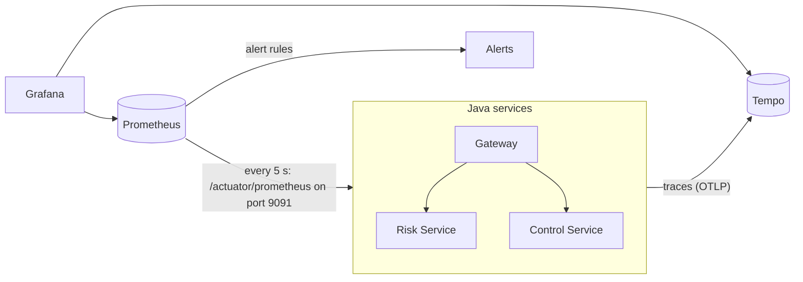

# Monitoring

What the platform is doing at any moment: requests, speed, errors, the event flow between the services, and the security defences at work. It starts with everything else (`node scripts/start.mjs`).

| Where | What |
| --- | --- |
| http://localhost:3000 | **Grafana**: three dashboards. Anyone can view; changing them needs `admin` and `GRAFANA_ADMIN_PASSWORD` from `.env`. |
| http://localhost:9090 | **Prometheus**: raw metrics, scrape targets (*Status → Targets*) and alerts (*Alerts*). |
| Grafana → *Explore* → Tempo | **Traces**: one request, hop by hop, across the Gateway, both services and Kafka. |
| `docker compose logs <service>` | **Logs**: one JSON object per line, each carrying the request's `traceId`. |

Check that it all works: `node scripts/check-monitoring.mjs` (10 checks; makes a little real activity first).

## How it fits together

- **Metrics** (Micrometer): every service counts its requests, timings, JVM memory and CPU, Kafka consumer lag and cache hits, plus the platform's own numbers below. Prometheus collects them every 5 seconds and keeps 7 days.
- **Traces** (OpenTelemetry, stored in Tempo): every request gets a trace id that travels with it: through the Gateway to a service, into the outbox row it writes, out to Kafka, and into the other service. One control test is one trace of about ten steps.
- **Logs** are JSON (Elastic Common Schema) with `traceId` and `spanId`, so all the lines for one request can be found in every service.
- **Alerts** are Prometheus rules in [deploy/monitoring/alerts.yml](../deploy/monitoring/alerts.yml), shown on the overview dashboard. Nothing is sent anywhere (no email or chat); that would be an Alertmanager added in a real deployment.

Metrics, health and probes are on a **separate management port (9091) that isn't published**: Prometheus reaches it on the Docker network, and the API ports never serve them (the security attack suite checks this).

## The dashboards

**Platform overview** (Grafana's home page): services up, requests per second, p95 response time, server errors, firing alerts; requests and latency by service; Gateway responses by status; slowest endpoints; memory and CPU by service. Dots on the latency chart are *exemplars*: individual requests, each linked to its trace.

**Events**: the time from a control test to the linked risks' new scores (p50 and p95), tests recorded by result, events received by outcome (*applied*, *no change*, *duplicate*, *rejected signature*), events sent to Kafka, outbox backlog, Kafka consumer lag and the risk cache's hit ratio.

**Security**: failed and throttled sign-ins, rate-limited requests, requests refused at the Gateway by reason (401, 411, 413, 429), requests refused by the services (roles, ownership, segregation of duties) and forged events rejected. Each panel is one defence from the [security review](security-review.md).

Health checks and Prometheus's own scrapes are left out of every request chart: they are HTTP requests too, and made an idle platform look busy.

## The platform's own metrics

| Metric | Service | Meaning |
| --- | --- | --- |
| `rcp_assessment_to_rescore_seconds` | Risk | From a test being recorded to the linked risks being rescored (histogram) |
| `rcp_events_consumed_total{topic, outcome}` | both | Every event received, and what happened to it |
| `rcp_outbox_pending` | both | Events saved but not yet sent to Kafka |
| `rcp_outbox_published_total{topic}` | both | Events sent to Kafka |
| `rcp_assessments_recorded_total{result}` | Control | Tests recorded |
| `rcp_logins_total{outcome}` | Gateway | Sign-ins: success, failure, throttled |

Every counter is registered at 0 when its service starts. Prometheus can't see the first rise of a counter that first appears already at 1 or 2, which at first hid the first forged events from the dashboard.

## Alerts

| Alert | When | Severity |
| --- | --- | --- |
| ServiceDown | A service doesn't answer Prometheus for 15 s | critical |
| ForgedEventRejected | A Kafka event without a valid signature arrived in the last 5 minutes | critical |
| HighErrorRate | Over 5% of a service's requests are server errors for 2 minutes | warning |
| SlowRequests | p95 response time over 1 s for 5 minutes | warning |
| OutboxBacklog | Over 50 events waiting to go to Kafka for a minute | warning |
| SlowRescore | p95 from test to new score over 5 s for 5 minutes | warning |
| KafkaConsumerLag | A consumer over 100 messages behind for 2 minutes | warning |
| SignInAttack | Over 0.5 failed or throttled sign-ins a second for a minute | warning |

## Try it yourself

1. Open http://localhost:3000 next to the app (http://localhost:5173).
2. **A test reaching the score.** Sign in as carol and record a test on any control. On the *Events* dashboard, "Tests recorded" goes up, events show as *applied*, and "Test → new score" shows how long it took (about half a second).
3. **One request, end to end.** In Grafana, *Explore* → *Tempo* → *Search*, service `control-service`, then open the newest `http post /api/controls/{controlId}/assessments`: the Gateway, the Control Service, the outbox, Kafka, the Risk Service and back.
4. **An alert.** `docker compose stop control-service`. Within 30 seconds "Services up" shows 2 and *ServiceDown* fires on the overview. Then `docker compose start control-service`.
5. **The security dashboard.** Run `node security/attack-tests.mjs` and watch the *Security* dashboard fill with refused sign-ins and requests.

## Settings

| Setting (`.env`) | Default | |
| --- | --- | --- |
| `GRAFANA_ADMIN_PASSWORD` | random, from `start.mjs` | Grafana's admin account |
| `TRACING_SAMPLE_RATE` | `1.0` | Share of requests traced; lower it for load tests |

Locally, every request is traced and kept for 24 hours. The monitoring containers use about 1 GB of memory and 1.5 CPUs at most (limits in `compose.yaml`).

## Known limits

- Single Prometheus and Tempo with local disk: fine on one machine; a real deployment would use managed or replicated storage and an Alertmanager to notify people.
- Logs stay in Docker (`docker compose logs`); there is no log search store such as Loki. The trace id in every line is what ties them to traces.
- The database, Kafka and Redis containers have no exporters, so their internals (disk, connections) aren't charted; the services' view of them (latency, lag, cache hits, outbox) is.
